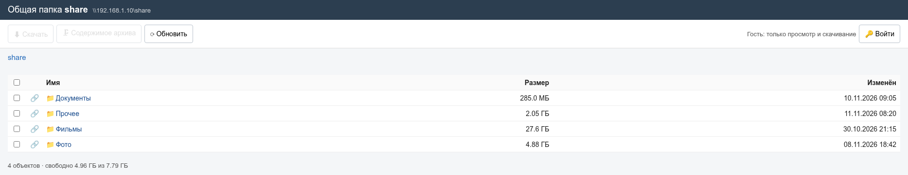

# web-share — веб-файловый менеджер общей папки

[](https://github.com/DrVidjet/web-share/actions/workflows/ci.yml)

Это файловый менеджер для одной папки на сервере, работающий в браузере. Можно просматривать файлы, скачивать их
(папки — одним zip), загружать, делиться ссылками и смотреть архивы. Сервер написан на Python 3 только со
стандартной библиотекой, HTML/CSS/JS встроены в него. Работает на **Linux** (служба systemd; при желании
`start.sh` настроит и Samba-шару для той же папки) и на **Windows** (задача планировщика от SYSTEM).



## Быстрый старт

**Linux** (Debian 10–13, Ubuntu, Astra, Fedora/RHEL, Arch, openSUSE — с systemd, можно на голую систему):

```bash
curl -fsSL https://raw.githubusercontent.com/DrVidjet/web-share/HEAD/install.sh | sudo bash
```

**Windows** 10/11, Server 2016+ — в PowerShell (права администратора запросятся сами):

```powershell
irm https://raw.githubusercontent.com/DrVidjet/web-share/HEAD/install.ps1 | iex
```

Обновление — та же команда (ответы возьмутся из прошлой установки). Параметры передаются так:

```bash
curl -fsSL https://raw.githubusercontent.com/DrVidjet/web-share/HEAD/install.sh | sudo bash -s -- -y           # без вопросов
curl -fsSL https://raw.githubusercontent.com/DrVidjet/web-share/HEAD/install.sh | sudo bash -s -- --uninstall
```
```powershell
& ([scriptblock]::Create((irm https://raw.githubusercontent.com/DrVidjet/web-share/HEAD/install.ps1))) -Yes
& ([scriptblock]::Create((irm https://raw.githubusercontent.com/DrVidjet/web-share/HEAD/install.ps1))) -Uninstall
```

Установщик скачивает проект во временную папку и запускает из него `start.sh` (Linux) или `start.ps1` (Windows),
дальше всё как при ручной установке ниже.

## Установка на Linux (из клона)

```bash
git clone https://github.com/DrVidjet/web-share web-share && cd web-share
cp .env.example .env     # по желанию: поправить значения по умолчанию (все настройки - в этом файле)
sudo ./start.sh
```

Скрипт задаст вопросы: где общая папка, какой порт, логины и пароли, нужна ли Samba и т. д. Значение по умолчанию
показано в скобках, Enter его принимает, а `-` оставляет поле пустым. Затем скрипт сам:

- поставит недостающие пакеты через apt / dnf / pacman / zypper (`python3` с `venv`, при необходимости `cron`
  (`cronie`), `logrotate`, `samba`). На Debian 10 он переключит apt на `archive.debian.org`;
- создаст системного пользователя для службы и общую папку;
- скопирует программу в папку установки (по умолчанию `/opt/web-share`) и создаст там **виртуальное окружение
  `venv`**: служба запускается только из него;
- запишет итоговые настройки в `<папка установки>/.env`;
- создаст и запустит службу systemd, а при необходимости cron и Samba; откроет порт в ufw / firewalld, если они
  включены (для Samba на SELinux включит `samba_export_all_rw`);
- логи пишет в `<папка установки>/log` (`<служба>.log`, `<служба>-images-index.log`), ротация — logrotate
  (`/etc/logrotate.d/<служба>`, все `*.log` папки: раз в неделю или от 20 МБ, хранит 8, сжимает).
  `INSTALL_LOG_DIR=journal` — только журнал systemd. Уровень — `SHARE_LOG_LEVEL`;
- проверит, что страница отвечает, и покажет адреса и пароли.

```bash
sudo ./start.sh -y                  # без вопросов (значения по умолчанию или из прошлой установки)
sudo ./start.sh --answers my.env    # ответы из файла (KEY=VALUE, ключи как в .env.example)
sudo ./start.sh --uninstall         # убрать службу, cron, logrotate и Samba-конфиг; файлы общей папки не трогаются
```

**Обновление:** взять новую версию (`git pull`) и снова запустить `sudo ./start.sh`. Все ответы по умолчанию
возьмутся из `.env` прошлой установки, поэтому достаточно нажимать Enter (или запустить с `-y`).

В контейнере без systemd `start.sh` всё поставит и запишет unit, но службу не запустит, а напечатает команду
ручного запуска.

## Установка на Windows (из клона или zip)

Скачать проект (`git clone` или zip с GitHub) и запустить `start.cmd` (двойным щелчком или из консоли):

```bat
start.cmd                  :: вопросы, как у start.sh
start.cmd -Yes             :: без вопросов
start.cmd -Answers my.env  :: ответы из файла
start.cmd -Uninstall       :: убрать задачу и правило брандмауэра (общая папка не трогается)
```

`start.cmd` просто вызывает `start.ps1` (`powershell -ExecutionPolicy Bypass -File start.ps1`). Скрипт:

- попросит права администратора (UAC), если их нет;
- найдёт Python 3.7+, а если его нет — скачает с python.org и поставит Python 3.12 для всех пользователей
  (подпись установщика проверяется);
- скопирует программу в папку установки (по умолчанию `C:\Program Files\web-share`) и создаст там `venv`;
- запишет настройки в `<папка установки>\.env` (читать могут только SYSTEM и администраторы — там пароли);
- зарегистрирует задачу планировщика `web-share`: от SYSTEM, при загрузке и раз в 5 минут (если процесс упал —
  поднимется снова; если работает — повторный запуск пропускается);
- откроет порт в брандмауэре Windows (правило `web-share-http`);
- лог — `<папка установки>\log\web-share.log` (ротация в самой программе: 20 МБ, хранится 8);
- проверит, что страница отвечает, и покажет адреса и пароли.

Общая папка по умолчанию — `C:\Share`, можно и корень диска (`D:\`): служебные `$RECYCLE.BIN` и
`System Volume Information` в вебе скрыты (`SHARE_HIDE`). Samba и индекс docker-образов — только в Linux;
в Windows сетевой доступ к папке настраивается штатно (Свойства → Доступ), путь можно показать в шапке
через `SHARE_SMB_PATHS`. Управление: `Start-ScheduledTask web-share` / `Stop-ScheduledTask web-share`.

## Возможности

| | Гость | «только загрузка» | полный доступ |
|---|:-:|:-:|:-:|
| Просмотр, сортировка, скачивание файлов (с докачкой — HTTP Range) | ✅ | ✅ | ✅ |
| Скачивание папки одним `.zip` (потоком, с размером заранее и докачкой — Range; ZIP64 для больших) | ✅ | ✅ | ✅ |
| Просмотр содержимого архивов (zip, tar, tar.gz/bz2/xz, gz) и скачивание файла из архива | ✅ | ✅ | ✅ |
| «🔗 Поделиться»: ссылка на страницу файла или папки | ✅ | ✅ | ✅ |
| Столбец «Комментарий»: видеть | ✅ | ✅ | ✅ |
| Столбец «Комментарий»: писать / менять (щелчок по ячейке) | — | — | ✅ |
| Загрузка файлов и папок (кнопки и drag&drop), создание папок | — | только в папке загрузки | везде |
| Замена существующего файла | — | — | ✅ (спрашивает) |
| Переименование, копирование, перемещение, удаление | — | — | ✅ |

- Загрузка идёт очередью, по одному файлу; прогресс — одна общая шкала на всю очередь (файлов X из Y, объём, текущий файл), ошибки — свёрнутым списком под ней. Кнопка «Отменить» прерывает текущий файл и очищает очередь.
- Если часть файлов уже есть на сервере, перед загрузкой — одно окно со списком совпадений: «Заменить все» / «Пропустить все» / «Отменить загрузку» (у «только загрузки» совпадения сразу идут в ошибки — замена запрещена).
- Права проверяет сервер, а не только интерфейс.
- Сессия хранится в cookie, в памяти процесса, 12 часов. После перезапуска службы нужно войти снова.
- Открыть страницу можно только из сетей, перечисленных в `SHARE_ALLOW`.

### «Поделиться»

Кнопка 🔗 стоит в каждой строке, справа от галочки. Она копирует ссылку `http://<сервер>:<порт>/s/<путь>`
и показывает уведомление «Ссылка скопирована». По ссылке открывается отдельная страница с карточкой по центру:
значок по типу файла, имя, размер (у папки — ещё число файлов и папок), дата, кнопка **«Скачать»**
и ссылка «Открыть в общей папке».

### Комментарии

Столбец «Комментарий» стоит между «Имя» и «Размер». При полном доступе щёлкните по ячейке и введите текст: Enter или
щелчок мимо — сохранить, Esc — отмена. Пустой текст удаляет комментарий. По столбцу можно сортировать. Комментарий
также виден на странице «поделиться».

Комментарии хранятся вне общей папки, в `SHARE_COMMENTS_FILE` (по умолчанию `/var/lib/<служба>/comments.json`,
`StateDirectory` службы) по пути от корня. Переименование, перемещение, копирование и удаление **через веб-интерфейс**
переносят комментарии вместе с файлом (и с содержимым папки). Если переименовать или переместить файл мимо веба (Samba, ssh),
его комментарий пропадёт из списка, а ключ останется в файле.

### Обновление открытых страниц

После обновления сервера открытые вкладки перезагружаются сами: страница раз в минуту и при возврате на вкладку
сверяет свою сборку (хэш HTML/JS страниц) с `GET /api/version`. Перезагрузка ждёт, пока пользователь ничего не делает:
нет загрузки файлов, открытых окон, правки комментария, незавершённых запросов и выделенных файлов (на скрытой вкладке
выделение не мешает). Папка, сортировка и прокрутка сохраняются, после перезагрузки — уведомление «Страница обновлена
до новой версии». Изменения только серверной части (без HTML/JS) страницы не перезагружают.

### Скачивание папки (zip)

Папка отдаётся одним `.zip` без сжатия, который собирается на лету, но раскладывается заранее: браузер сразу знает
размер (видны прогресс и оставшееся время), а при обрыве может **докачать** с места остановки (HTTP Range;
`ETag` / `If-Range` — если в папке что-то поменялось, архив отдаётся заново целиком). CRC файлов пишутся после данных,
так что отдача начинается сразу. Чтобы при докачке не перечитывать с диска всё, что уже ушло, CRC отданных файлов
запоминаются в `/var/lib/<служба>/zip-crc.json` (рядом с комментариями, до 100 000 файлов); если CRC нет — они
считаются в фоне, пока идёт докачка. Архив проверен на `unzip`, 7-Zip, bsdtar и Python `zipfile`, в т.ч. больше 4 ГБ (ZIP64).
Если файл меняется прямо во время отдачи — в лог предупреждение, в архиве этот файл будет испорчен (разметка архива не сбивается).

## Настройки — `.env`

Все настройки с комментариями перечислены в **`.env.example`**. Чтобы задать свои значения по умолчанию, скопируйте
его в `.env` (`.env` указан в `.gitignore` и в git не попадает). `start.sh` берёт значения в таком порядке:
`--answers` → `.env` прошлой установки → `.env` проекта (а если его нет, `.env.example`) → встроенные.
Пустое значение означает «не задано»: для паролей `start.sh` сгенерирует случайный.

Рабочий файл — `<папка установки>/.env`, права `640 root:<пользователь службы>`, потому что в нём пароли.
После ручной правки: `sudo systemctl restart web-share`, или просто снова запустить `start.sh`.

| Ключ | По умолчанию | |
|---|---|---|
| `SHARE_ROOT` | `/srv/share` | корень общей папки (точка монтирования данных); `SHARE_UPLOAD_DIR` и `INSTALL_DOCKER_INDEX_DIR` можно задавать относительно него — тогда при переезде шары меняется только эта строка |
| `SHARE_PORT` | `8081` | порт |
| `SHARE_BIND` | `0.0.0.0` | адрес, на котором слушать |
| `SHARE_ALLOW` | `10.0.0.0/8,172.16.0.0/12,192.168.0.0/16,127.0.0.0/8` | с каких сетей пускать (CIDR) |
| `SHARE_TITLE` | имя папки | название в шапке |
| `SHARE_HIDE` | `lost+found` | имена в корне общей папки, которых в вебе нет: не показываются, не открываются по ссылке, не попадают в zip (через запятую) |
| `SHARE_SMB_PATHS` | — | пути Samba через запятую, только для показа в шапке |
| `SHARE_USER` / `SHARE_PASS` | `admin` / случайный | полный доступ |
| `SHARE_UPLOAD_USER` / `SHARE_UPLOAD_PASS` | `upload` / случайный | «только загрузка»; пустой логин — выключено |
| `SHARE_UPLOAD_DIR` | `upload` | папка для «только загрузки», путь от корня |
| `SHARE_SESSION_HOURS` | `12` | сколько часов живёт вход |
| `SHARE_LOG_FILE` | — | файл лога с ротацией внутри программы (20 МБ × 8); пусто — stderr. В Windows его задаёт `start.ps1` |
| `SHARE_LOG_LEVEL` | `INFO` | уровень логов: `ERROR`, `WARNING` (неудачные входы, отказы, ошибки), `INFO` (+ действия: кто с какого адреса вошёл, скачал, загрузил, переименовал, удалил…), `DEBUG` (+ каждый HTTP-запрос) |
| `INSTALL_LOG_DIR` | `<папка установки>/log` | папка логов; `journal` — только журнал systemd |
| `INSTALL_*` | | для `start.sh`: папка, служба, пользователь, docker-индекс, Samba (`INSTALL_SMB_WORM_GRACE` — 30 с); программа их не читает |

Те же ключи можно передать переменными окружения, они важнее файла.

## Логи

Папка — `INSTALL_LOG_DIR` (по умолчанию `<папка установки>/log`, владелец root, группа службы, 775):

| Файл | Кто пишет |
|---|---|
| `<служба>.log` | веб-интерфейс (systemd `StandardOutput=append:`) |
| `<служба>-images-index.log` | cron индекса docker-образов (от пользователя службы) |

Строка: `2026-11-18 15:47:26 INFO [192.168.10.214 backups] удалён iso/old.iso` — время, уровень, адрес и логин
(`гость` без входа), действие. Уровень — `SHARE_LOG_LEVEL`:

- `ERROR` — сбои при обработке запросов (с трассировкой);
- `WARNING` — плюс неудачные входы, отказы 401/403 (нет входа, нет прав, адрес не из `SHARE_ALLOW`),
  нечитаемый файл комментариев;
- `INFO` (по умолчанию) — плюс действия: вход/выход, скачивание файла / папки (zip, с размером; докачка — с какого места;
  «отдана до конца») / файла из архива, **обрыв скачивания** (сколько отдано из скольких, за сколько секунд), загрузка
  (с размером, «заменён»), создание папки, переименование, копирование, перемещение, удаление, комментарии;
  прочие отказы (404, 409 «уже существует»…);
- `DEBUG` — плюс каждый HTTP-запрос, куски докачки файлов (Range), оборванные соединения прочих запросов.

Ротация — logrotate, `/etc/logrotate.d/<служба>`: все `*.log` папки, раз в неделю или от 20 МБ, хранит 8 сжатых
(`copytruncate` — служба не перезапускается). Уровень меняется в `<папка установки>/.env`, затем `systemctl restart <служба>`.
С `INSTALL_LOG_DIR=journal` — журнал: `journalctl -u <служба>`.

## Samba (по желанию)

Если на вопрос про Samba ответить «да», `start.sh` создаст `/etc/samba/<служба>.conf` и подключит его строкой
`include` в `smb.conf`:

- `[<имя>]` — общая папка: гость только читает, `SHARE_USER` пишет, файлы создаются от пользователя службы;
- `[<имя>-upload]` — папка загрузки, только для `SHARE_UPLOAD_USER`. Модуль `vfs_worm`
  (`worm:grace_period = 30`) запрещает изменять, переименовывать и удалять всё, чему больше 30 секунд,
  поэтому можно только добавлять новое.

Пароли Samba совпадают с паролями веб-интерфейса. Для логинов создаются системные пользователи без shell.

## Индекс docker-образов (по желанию)

Если указать папку с docker-образами (`docker save` → `.tar`, `.tar.gz`, `.tgz`, `.gz`), cron раз в 5 минут
будет обновлять в ней `images.list`. В каждой строке: `<образ:тег> <путь> <размер> <mtime>`.

## Файлы

```
install.sh                Linux: установка одной командой (curl | sudo bash) - скачивает проект и запускает start.sh
start.sh                  Linux: установка / обновление / удаление
install.ps1               Windows: установка одной командой (irm | iex) - скачивает проект и запускает start.ps1
start.ps1, start.cmd      Windows: установка / обновление / удаление
.env.example              все настройки с комментариями (скопировать в .env)
share-web.py              сервер + страница (PAGE) + страница «поделиться» (SHARE_PAGE)
share-images-index.sh     индекс docker-образов: share-images-index.sh <папка>
requirements.txt          зависимостей Python нет - только список системных требований
tests/test_web.py         тесты HTTP API (Linux и Windows, только stdlib)
tests/container.sh        проверка start.sh в контейнере дистрибутива
.github/workflows/ci.yml  CI
```

После установки: `<папка установки>/{share-web.py, share-images-index.sh, venv/, .env, log/}`,
`/etc/systemd/system/<служба>.service`, `/var/lib/<служба>/` (комментарии `comments.json`, кэш CRC для zip `zip-crc.json`), а также `/etc/cron.d/<служба>-images-index`, `/etc/logrotate.d/<служба>` и `/etc/samba/<служба>.conf`,
если они включены.

## Запуск для разработки

```bash
python3 -m venv .venv
cp .env.example .env    # и вписать SHARE_ROOT, SHARE_PASS... - программа читает .env рядом с собой
.venv/bin/python3 -I share-web.py     # Windows: .venv\Scripts\python.exe -I share-web.py
```

## Тесты и CI

```bash
python3 tests/test_web.py -v                                          # API: настоящий сервер во временной папке
docker run --rm -v "$PWD:/src:ro" fedora bash /src/tests/container.sh   # start.sh в любом дистрибутиве
```

GitHub Actions (`.github/workflows/ci.yml`, при каждом push/PR и раз в неделю):

- **lint** — `bash -n`, shellcheck, ruff, vermin (совместимость `share-web.py` с Python 3.7);
- **tests** — `tests/test_web.py` в Ubuntu и Windows на Python 3.8 и 3.13, отдельно на 3.7;
- **distros** — `tests/container.sh` в Debian 10/12/13, Ubuntu 24.04, Fedora, Arch, openSUSE Tumbleweed:
  пакеты, venv, пользователь, unit, cron, logrotate, Samba, запуск, индекс образов, удаление;
- **linux-systemd** — `install.sh` на раннере с настоящим systemd: служба и smbd запущены, обновление, удаление;
- **windows** — разбор скриптов в Windows PowerShell 5.1, PSScriptAnalyzer, `install.ps1 -Yes`, вход и
  загрузка через API, обновление, удаление.

## API

| Метод и путь | Кто | |
|---|---|---|
| `GET /` | все | файловый менеджер |
| `GET /s/<путь>` | все | страница «поделиться» |
| `GET /api/me` | все | `{admin, role, upload_dir}` |
| `GET /api/version` | все | `{build}` — сборка страниц (для автообновления открытых вкладок) |
| `GET /api/list?path=` | все | содержимое папки (с `comment`) + свободное место |
| `GET /api/info?path=` | все | имя, тип, размер, дата (у папки — `files`, `dirs`) |
| `GET /dl?path=` | все | скачать файл или папку (`.zip`, `ETag`); оба — с Range (докачка) |
| `GET /api/archive?path=` | все | список файлов в архиве |
| `GET /api/archive_get?path=&member=` | все | скачать файл из архива |
| `POST /api/login` `{user, pass}` / `POST /api/logout` | — | вход и выход |
| `POST /api/exists` `{path, names}` | все | какие из `names` (пути от `path`) уже есть — проверка перед загрузкой |
| `PUT /api/upload?path=&name=[&overwrite=1]` | полный, «загрузка» (в своей папке) | тело — содержимое файла; `name` может содержать подпапки |
| `POST /api/mkdir` `{path, name}` | полный, «загрузка» (в своей папке) | новая папка |
| `POST /api/rename` `{path, name}` | полный | переименование |
| `POST /api/paste` `{op: copy\|move, src: [...], dest}` | полный | копирование и перемещение |
| `POST /api/delete` `{paths: [...]}` | полный | удаление |
| `POST /api/comment` `{path, text}` | полный | комментарий к файлу/папке (пустой `text` — удалить) |

Требования: Python 3.7+ (только stdlib); Linux с systemd или Windows 10/11 / Server 2016+.
